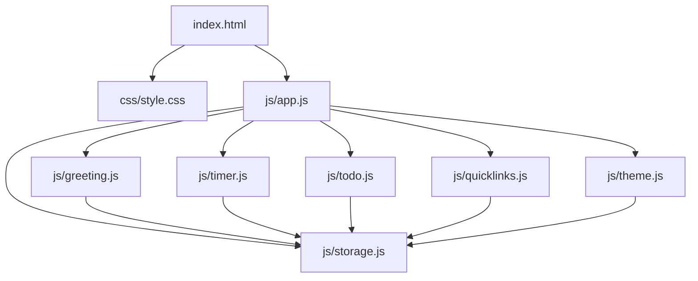
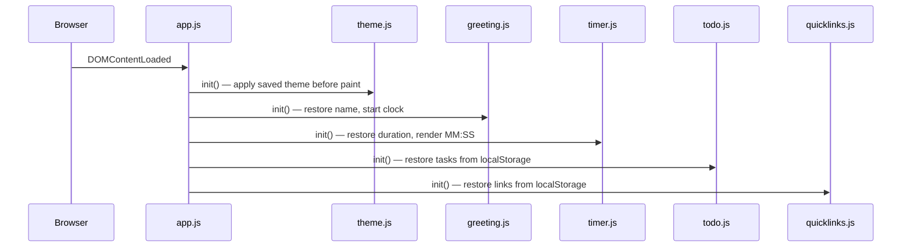

# Design Document: Todo List Life Dashboard

## Overview

The Todo List Life Dashboard is a single-page, client-side web application composed of four productivity widgets — a Greeting Widget, a Pomodoro Focus Timer, a To-Do List, and a Quick Links launcher — plus a Light/Dark Theme Toggle. It is built with plain HTML, CSS, and Vanilla JavaScript: no frameworks, no build step, and no external network requests at runtime. All persistent state lives in the browser's `localStorage`.

The design follows a **module-per-widget** structure: each widget owns its own state-management logic, DOM-rendering functions, and `localStorage` read/write helpers. A thin top-level `app.js` bootstraps all modules in the correct order on `DOMContentLoaded`.

**Key design decisions:**

| Decision | Rationale |
|---|---|
| Vanilla JS modules (ES module `<script type="module">`) | No build tooling required; native browser support across Chrome, Firefox, Edge, and Safari. |
| `localStorage` as the only persistence layer | Keeps the app purely client-side; meets Requirement 6.8. |
| CSS custom properties for theming | A single attribute swap on `<html data-theme="dark">` re-skins every surface with zero JavaScript per-element logic. |
| `setInterval`-based clock ticking at 1 s | Simple, reliable for HH:MM display updated at the minute boundary. |
| Web Audio API for timer completion alert | No audio file dependency; synthesised beep generated in-browser. |

---

## Architecture

The app is a single HTML file (`index.html`) that loads one CSS file (`css/style.css`) and one JavaScript entry point (`js/app.js`) as an ES module. `app.js` imports four widget modules and one shared utility module.



**Module responsibilities:**

| Module | Role |
|---|---|
| `app.js` | Entry point; calls `init()` on each module after DOM is ready; applies theme before first paint. |
| `greeting.js` | Clock interval, greeting-prefix logic, name persistence. |
| `timer.js` | Countdown interval, Web Audio alert, duration persistence. |
| `todo.js` | Task CRUD, optimistic DOM updates, 500 ms debounced `localStorage` sync. |
| `quicklinks.js` | Link CRUD, URL validation, tab-open behaviour. |
| `theme.js` | Theme toggle, `data-theme` attribute management, flash-free init. |
| `storage.js` | Thin wrappers around `localStorage.getItem` / `setItem` with try/catch; returns `null` on failure and exposes an `isAvailable()` helper. |

**Rendering model:** Each module directly manipulates the DOM section it owns. There is no virtual DOM or reactive framework — every mutation is an explicit function call triggered by user events or timers. This keeps the runtime footprint minimal and predictable.

**Startup sequence:**



---

## Components and Interfaces

### 1. Greeting Widget (`greeting.js`)

**DOM target:** `#greeting-widget`

**Public API:**

```js
greetingModule.init()          // Restores name, starts clock interval, binds save button
greetingModule.getGreetingPrefix(hour: number): string  // Pure – returns "Good morning" etc.
```

**Behaviour:**
- A `setInterval` fires every second. On each tick it reads `Date().getMinutes()`. When minutes change, it updates the HH:MM display.
- `getGreetingPrefix` maps the current hour to a prefix using four exclusive numeric ranges (05–11, 12–17, 18–20, 21–04).
- Name save: validates 1–50 chars, writes to `localStorage`, updates the displayed greeting, shows a `.confirmation-badge` element for 2 000 ms then hides it.
- If `storage.isAvailable()` returns `false` on save, displays an `.error-badge` instead without writing.

### 2. Focus Timer (`timer.js`)

**DOM target:** `#timer-widget`

**Public API:**

```js
timerModule.init()             // Restores duration, renders display, binds controls
timerModule.getGreetingPrefix  // (not exported — internal only)
```

**Internal state:**

```js
{ remainingSeconds: number, intervalId: number|null, durationMinutes: number }
```

**Controls:** Start, Stop, Reset, and a duration-input field.

**Behaviour:**
- **Start:** If `remainingSeconds === 0`, resets to `durationMinutes * 60` first. Calls `setInterval(tick, 1000)`.
- **Stop:** Calls `clearInterval`, retains `remainingSeconds`.
- **Reset:** Calls `clearInterval`, sets `remainingSeconds = durationMinutes * 60`, re-renders.
- **Tick:** Decrements `remainingSeconds`, re-renders MM:SS. At zero: `clearInterval`, call `playAlert()`, show `.completion-badge`.
- **`playAlert()`:** Creates an `AudioContext`, connects an `OscillatorNode` (sine, 440 Hz), starts and stops after 1 s. Wrapped in try/catch — on failure, only the visual badge is shown.
- **Duration save:** Validates 1–60 (integer), persists to `localStorage`, updates `durationMinutes`. Resets display if no session is active.

### 3. To-Do List (`todo.js`)

**DOM target:** `#todo-widget`

**Public API:**

```js
todoModule.init()   // Restores tasks, renders list, binds add control
```

**Internal state:**

```js
tasks: Array<{ id: string, text: string, completed: boolean }>
```

IDs are generated with `crypto.randomUUID()` (baseline support across all four target browsers).

**Behaviour:**
- **Add:** Validates non-empty, ≤ 200 chars. Pushes new task object, re-renders, schedules save.
- **Toggle:** Flips `completed`, re-renders item, schedules save.
- **Edit:** Replaces task row with an inline edit form. On confirm: validates non-empty, ≤ 200 chars, updates text, re-renders, schedules save. On cancel: re-renders without change.
- **Delete:** Removes task by `id`, re-renders, schedules save.
- **Debounced save:** A 500 ms `setTimeout` (reset on each change) writes the full array to `localStorage` as JSON.
- **Load:** `JSON.parse(localStorage.getItem('todo_tasks'))`. On `null` or parse error: renders empty list, shows `.storage-error` message.

### 4. Quick Links (`quicklinks.js`)

**DOM target:** `#quicklinks-widget`

**Public API:**

```js
quicklinksModule.init()   // Restores links, renders buttons, binds add form
```

**Internal state:**

```js
links: Array<{ id: string, label: string, url: string }>
```

**Validation rules (applied before any mutation):**
1. Label non-empty, ≤ 50 chars.
2. URL non-empty, ≤ 2 048 chars.
3. URL starts with `http://` or `https://`.
4. URL not already present in `links` (case-sensitive comparison).
5. `links.length < 20` (hard cap).

**Behaviour:**
- **Add:** Passes all five validation rules, pushes new link, re-renders, persists.
- **Open:** `window.open(url, '_blank', 'noopener,noreferrer')`.
- **Delete:** Removes by `id`, re-renders, persists.
- **Load:** On parse error or absent key: renders empty list silently (no user-facing error — per Req 4.9).

### 5. Theme Toggle (`theme.js`)

**DOM target:** `#theme-toggle`

**Public API:**

```js
themeModule.init()          // Called FIRST in app.js — reads localStorage and sets data-theme before paint
themeModule.toggle()        // Flips theme, persists
```

**Behaviour:**
- `init()` reads `localStorage.getItem('theme')`. Applies `"dark"` if stored value is `"dark"`, else defaults to `"light"`. Sets `document.documentElement.setAttribute('data-theme', value)`.
- `toggle()` reads current attribute, inverts, writes attribute, persists new value.
- CSS selects on `[data-theme="dark"]` to override custom property values.

### 6. Storage Utility (`storage.js`)

```js
storage.get(key: string): any | null
storage.set(key: string, value: any): boolean   // returns false on QuotaExceededError or SecurityError
storage.isAvailable(): boolean
```

All methods wrap `localStorage` calls in try/catch. `set` serialises with `JSON.stringify`; `get` deserialises with `JSON.parse`. Returns `null` / `false` on any exception.

---

## Data Models

### localStorage Keys

| Key | Type | Description |
|---|---|---|
| `greeting_name` | `string` | User's display name, 1–50 chars |
| `timer_duration` | `string` (number) | Pomodoro duration in whole minutes, 1–60 |
| `todo_tasks` | `string` (JSON) | Serialised `Task[]` |
| `quicklinks_links` | `string` (JSON) | Serialised `Link[]` |
| `theme` | `"light"` \| `"dark"` | Active theme identifier |

### Task

```ts
interface Task {
  id: string;        // crypto.randomUUID() — 36-char UUID v4
  text: string;      // 1–200 chars
  completed: boolean;
}
```

### Link

```ts
interface Link {
  id: string;        // crypto.randomUUID()
  label: string;     // 1–50 chars
  url: string;       // 1–2048 chars, must start with http:// or https://
}
```

### Theme

```ts
type Theme = "light" | "dark";
```

**Serialisation round-trip guarantee:** `Task[]` and `Link[]` are stored as `JSON.stringify(array)` and restored with `JSON.parse`. Because both types contain only JSON-safe primitives (`string`, `boolean`), no custom serialiser is needed and the round-trip is lossless.

---

## Correctness Properties

*A property is a characteristic or behavior that should hold true across all valid executions of a system — essentially, a formal statement about what the system should do. Properties serve as the bridge between human-readable specifications and machine-verifiable correctness guarantees.*

### Property 1: Greeting prefix covers every hour

*For any* integer hour `h` in [0, 23], `getGreetingPrefix(h)` SHALL return exactly one of "Good morning", "Good afternoon", "Good evening", or "Good night" — never `undefined`, never an empty string, and never two prefixes simultaneously.

**Validates: Requirements 1.3, 1.4, 1.5, 1.6**

### Property 2: Task list grows by exactly one on valid add

*For any* task list of arbitrary length and any non-empty string of ≤ 200 characters, calling `addTask(text)` SHALL increase the task list length by exactly 1 and the new task SHALL appear as the last element with `completed = false`.

**Validates: Requirements 3.1, 3.2**

### Property 3: Whitespace-only and over-length inputs are rejected

*For any* string that is either empty, composed entirely of whitespace characters, or longer than 200 characters, calling `addTask(text)` SHALL leave the task list unchanged.

**Validates: Requirements 3.3, 3.4**

### Property 4: Task completion toggle is its own inverse

*For any* task list and any task `t` within it, toggling `t` twice SHALL return `t.completed` to its original value and leave all other tasks unchanged.

**Validates: Requirements 3.6, 3.7**

### Property 5: Task serialisation round-trip

*For any* array of `Task` objects, serialising it to JSON and immediately deserialising SHALL produce an array where each element is deeply equal to the original.

**Validates: Requirements 3.13, 3.14**

### Property 6: Edit rejects invalid inputs without data loss

*For any* task with text `T` and any proposed replacement that is either empty or exceeds 200 characters, calling `editTask(id, replacement)` SHALL leave `task.text` equal to `T` and the task list length unchanged.

**Validates: Requirements 3.10, 3.11**

### Property 7: Quick Links URL validation is consistent

*For any* string `u`, the URL validator SHALL accept it if and only if `u` starts with `"http://"` or `"https://"`, `u` is non-empty, and `u.length ≤ 2048`; for all other strings it SHALL reject.

**Validates: Requirements 4.3, 4.4**

### Property 8: Quick Links duplicate rejection

*For any* existing link list and any URL `u` already present in the list, calling `addLink({ label, url: u })` SHALL leave the link list unchanged.

**Validates: Requirements 4.5**

### Property 9: Link list serialisation round-trip

*For any* array of `Link` objects, serialising to JSON and deserialising SHALL produce an array where each element is deeply equal to the original.

**Validates: Requirements 4.2, 4.8**

### Property 10: Theme toggle is its own inverse

*For any* initial theme value `v` ∈ { "light", "dark" }, calling `toggle()` twice SHALL restore the `data-theme` attribute to `v` and the value persisted in `localStorage` to `v`.

**Validates: Requirements 5.2, 5.3, 5.4**

### Property 11: Timer display format validity

*For any* integer `remainingSeconds` in [0, 3600], the MM:SS display function SHALL return a string that matches the regular expression `^\d{2}:\d{2}$` with the minutes value in [00, 60] and the seconds value in [00, 59].

**Validates: Requirements 2.1, 2.2**

### Property 12: Pomodoro duration range enforcement

*For any* integer input `d`, the duration validator SHALL accept it if and only if `d` is an integer in [1, 60]; for all values outside this range (including floats, strings, and negative numbers), it SHALL reject.

**Validates: Requirements 2.8, 2.10**

---

## Error Handling

| Scenario | Module | Behaviour |
|---|---|---|
| `localStorage` unavailable on name save | `greeting.js` | Display session-only greeting; show persistent `.error-badge` with explanation (Req 1.10). |
| `localStorage` unavailable on duration save | `timer.js` | Apply duration for current session; show inline error message (Req 2.9). |
| `localStorage` unavailable or parse error on task load | `todo.js` | Render empty list; show `.storage-error` banner (Req 3.15). |
| `localStorage` unavailable on task save | `todo.js` | Log silently; display no blocking error (best-effort — no explicit requirement for mid-session failure). |
| `localStorage` parse error on link load | `quicklinks.js` | Render empty list silently — no error shown (Req 4.9). |
| `localStorage` unavailable on link save | `quicklinks.js` | Log silently. |
| Web Audio API unsupported | `timer.js` | Skip `playAlert()`; show visual completion badge only (Req 2.6). |
| `AudioContext` creation throws | `timer.js` | Catch exception; show visual completion badge only (Req 2.6). |
| Task text validation failure | `todo.js` | Reject add/edit; show inline `.validation-error`; keep focus on input. |
| Link form validation failure | `quicklinks.js` | Reject add; show inline `.validation-error` per failing field. |
| Timer duration validation failure | `timer.js` | Reject save; show inline `.validation-error` with "1–60 minutes" message (Req 2.10). |

**General principle:** No error state should crash or freeze the entire Dashboard. Each widget catches its own exceptions. The `storage.js` utility ensures `localStorage` failures never propagate uncaught.

---

## Testing Strategy

### Unit Tests (Vitest)

Unit tests target pure functions and state logic, executed with `vitest --run` for single-pass CI runs.

**Greeting:**
- `getGreetingPrefix` for all 24 hours — confirm correct prefix, full coverage.
- Name validation: 0 chars (reject), 1 char (accept), 50 chars (accept), 51 chars (reject).

**Timer:**
- MM:SS formatter for boundary values: 0 s → "00:00", 1 500 s → "25:00", 3 600 s → "60:00".
- Duration validator: 0 (reject), 1 (accept), 60 (accept), 61 (reject), 1.5 (reject), "abc" (reject).
- State transitions: start → tick → stop → start (resume) → reset.

**To-Do:**
- Add with valid text, empty text, 200-char text (accept), 201-char text (reject).
- Edit with valid text, empty text, over-length text.
- Toggle completion twice returns to original state (concrete example).
- Delete removes correct task by ID.

**Quick Links:**
- URL validator: valid http, valid https, missing protocol, ftp:// (reject), empty (reject), 2 048-char (accept), 2 049-char (reject).
- Duplicate URL rejection.
- Label validation: empty (reject), 50 chars (accept), 51 chars (reject).

**Theme:**
- `init()` with `"dark"` in storage sets attribute to `"dark"`.
- `init()` with absent key defaults to `"light"`.
- `toggle()` from light → dark, then dark → light.

**Storage utility:**
- `get` on absent key returns `null`.
- `set` then `get` round-trip returns original value.
- `isAvailable()` returns `true` in jsdom environment.

### Property-Based Tests (fast-check, minimum 100 iterations each)

Each property test maps directly to a Correctness Property in this document and is tagged with a comment:

```
// Feature: todo-life-dashboard, Property N: <property text>
```

| Property | Test description |
|---|---|
| **P1** – Greeting prefix covers every hour | Generate random integer in [0, 23]; assert result is one of four expected strings. |
| **P2** – Task list grows by one on valid add | Generate arbitrary task array + string in [1, 200] chars; assert length +1 and last element matches. |
| **P3** – Invalid add leaves list unchanged | Generate arbitrary string that is empty, whitespace-only, or > 200 chars; assert list unchanged. |
| **P4** – Toggle is its own inverse | Generate task array + random index; toggle twice; assert `completed` unchanged for all tasks. |
| **P5** – Task serialisation round-trip | Generate array of Task objects; `JSON.parse(JSON.stringify(arr))`; deep-equal assert. |
| **P6** – Edit rejects invalid replacement | Generate task + invalid string; assert text unchanged. |
| **P7** – URL validator consistency | Generate arbitrary string; assert validator agrees with the prefix + length rule. |
| **P8** – Duplicate URL rejection | Generate link list + pick existing URL; assert list length unchanged after add attempt. |
| **P9** – Link serialisation round-trip | Generate array of Link objects; `JSON.parse(JSON.stringify(arr))`; deep-equal assert. |
| **P10** – Theme toggle inverse | Start from either "light" or "dark"; toggle twice; assert returned to initial value. |
| **P11** – Timer display format | Generate integer in [0, 3600]; assert display string matches `^\d{2}:\d{2}$`. |
| **P12** – Pomodoro duration range | Generate arbitrary integer/float/string; assert validator accepts iff value is integer in [1, 60]. |

### Integration / Smoke Tests (manual + browser DevTools)

These verify wiring, not logic, and are run manually in each of the four target browsers:

1. **Cold load:** Clear `localStorage`, open `index.html`; confirm all four widgets render, theme defaults to light, timer shows 25:00, task list is empty.
2. **Persistence round-trip:** Add a task, add a link, change name, change theme; hard-reload; confirm all values restored.
3. **Storage unavailable:** Override `localStorage.setItem` to throw; confirm per-widget error messages appear without crashing other widgets.
4. **Timer alert:** Let timer count down to 00:00 in a browser with audio enabled; confirm audible beep and completion badge.
5. **Responsive layout:** Resize viewport to 320 px and 2 560 px; confirm no overlap, clipping, or horizontal scroll.
6. **Cross-browser:** Run steps 1–5 in Chrome, Firefox, Edge, and Safari.
